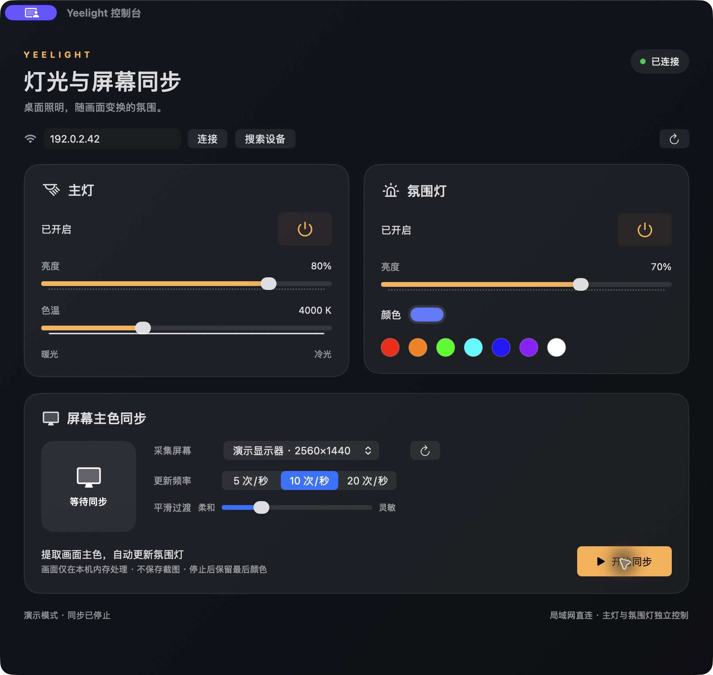
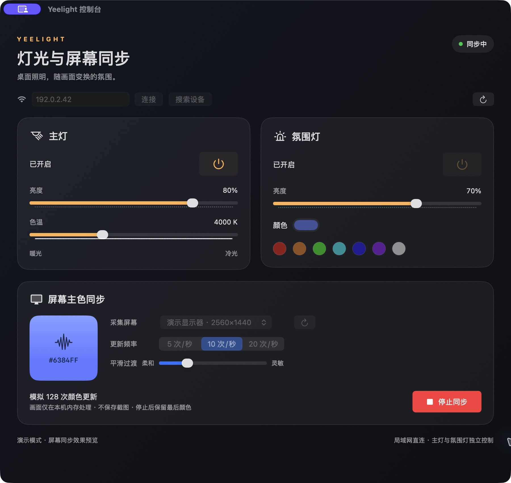

# Yeelight Screen Sync

**Native macOS light-bar controls, with local screen colour sync.**

[中文介绍与详细界面说明](README.md) · [MIT License](LICENSE) · [Code review](docs/REVIEW.md)



A runnable demo of local light-bar control and screen colour sync.

Control the main lamp and ambient backlight from one SwiftUI window. Match the ambient colour to the dominant colour of a selected display. The app needs no cloud account or third-party runtime. A standard-library Python CLI is included.

## Interface

| Area | Controls |
| --- | --- |
| Connection bar | LAN discovery, device selection, explicit IP, connection status |
| Main lamp | Power, brightness, colour temperature |
| Ambient backlight | Independent power, brightness, colour picker, seven exact sRGB presets |
| Screen sync | Display selection, 5/10/20 Hz limit, smoothing, live colour preview, start/stop |



Manual colour and ambient power controls are disabled while syncing; brightness remains adjustable. Stop preserves the last colour. Closing the last window exits the app and ends capture.

Screenshots use `--demo`, which performs no network or screen operations. The address, display name, counters and device state are synthetic. `192.0.2.42` is a documentation address.

## Requirements

- macOS 14+ and Xcode Command Line Tools.
- A Wi-Fi Yeelight with LAN Control enabled, reachable from the Mac.
- Hardware validation: device model identifier `lamp15`, firmware 38. Other models are unverified.
- Screen sync requires `udp_sess_new` and `bg_set_rgb`. White-only or non-Wi-Fi models are not supported by this feature.

## Build

```sh
git clone https://github.com/pengwubj/yeelight-screen-sync.git
cd yeelight-screen-sync
./build-app.sh
open "dist/Yeelight Screen Sync.app"
```

`UNIVERSAL=1 ./build-app.sh` builds arm64 + x86_64. Local builds are ad hoc signed and not notarized; `SIGN_IDENTITY` accepts your own signing identity.

Discover or enter your own light IP. No device address is bundled. Allow Local Network access if prompted. Screen sync requests screen-recording permission only when you use it. Enable the app under System Settings → Privacy & Security → Screen & System Audio Recording, then quit and reopen. Audio capture is disabled.

A rebuild changes the local signature. If an existing permission no longer works, remove the old entry, add the current app and reopen it.

## Privacy and limitations

Frames are downsampled and analysed in local memory. No screenshots or video are saved or uploaded. The only device traffic is lighting commands. The last connected IP stays in local app preferences; session tokens stay in memory. There is no project cloud service or analytics code.

The underlying LAN protocol is unencrypted: use a trusted network and do not expose the control ports publicly. Protected video, HDR and colour management can affect sampled colours. See [PRIVACY.md](PRIVACY.md).

## CLI and tests

```sh
python3 yeelight.py discover
python3 yeelight.py --ip "$LIGHT_IP" --bg color FF0000
./test.sh
python3 scripts/privacy_check.py
```

The CLI needs Python 3.10+, no packages. Supply your own `LIGHT_IP`. CLI power commands follow the firmware's raw channel semantics; the GUI attempts to preserve ambient power when toggling the main lamp.

Automated tests use only loopback or mocks. They cover colour extraction, smoothing, concurrent cleanup, device switching, offline demo isolation, fragmented TCP, absolute deadlines, UDP token validation, unrelated ACK rejection and a 40-second stream.

## Demo

```sh
open "dist/Yeelight Screen Sync.app" --args --demo
```

## License

MIT. An independent community project, not affiliated with Yeelight. Protocol references: [official LAN specification](https://www.yeelight.com/download/Yeelight_Inter-Operation_Spec.pdf) and [official Chroma Connector](https://github.com/Yeelight/Yeelight-Chroma-Connector). Vendor C++ sources, firmware and logos are not bundled.
