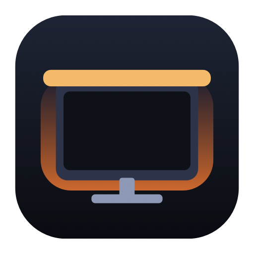

<div align="center">
  
  <h1>Yeelight Screen Sync</h1>
  <p>在 Mac 上控制挂灯，让氛围光跟着屏幕变换。</p>
  <p>Native macOS controls for Yeelight monitor light bars, with local screen colour sync.</p>
  <p><a href="README.en.md">English</a> · <a href="#界面介绍">界面介绍</a> · <a href="#开始使用">开始使用</a> · <a href="docs/REVIEW.md">代码审查</a></p>
  <a href="https://github.com/pengwubj/yeelight-screen-sync/actions/workflows/ci.yml"></a>
  <a href="LICENSE"></a>
  
</div>


这是一个可运行的 Demo，用来演示挂灯控制和屏幕主色同步。

一个原生 SwiftUI 桌面 App，把主灯控制、彩色氛围灯和屏幕主色同步放在同一个窗口。无需登录灯具云账号，也无需安装 Python 包。附带一个仅使用标准库的 Python 命令行工具。

## 界面介绍

| 区域 | 可以做什么 | 操作说明 |
| --- | --- | --- |
| 顶部连接栏 | 搜索局域网设备，或输入 IP 连接 | 多台设备时手动选择；右上角显示连接状态 |
| 主灯卡片 | 开关、1–100% 亮度、2700–6500 K 色温 | 先开灯再调节；滑块松开后发送命令 |
| 氛围灯卡片 | 独立开关、亮度、颜色选择器、24 种 RGB 预设 | 红、绿、蓝等预设使用精确的 sRGB 色值 |
| 屏幕同步卡片 | 选择显示器、更新频率、平滑程度 | 点击开始同步后，颜色预览与氛围灯一起更新 |

### 让氛围灯跟着画面走


- **选择屏幕**：支持连接到 Mac 的多个显示器，每次采集其中一个。
- **更新频率**：5 / 10 / 20 次每秒，为更新上限；静止画面减少重复发送。
- **平滑过渡**：偏向「柔和」可减轻跳色，偏向「灵敏」可更快响应画面变化。
- **实时预览**：显示当前颜色和更新次数。主灯保持独立控制。
- **一键停止**：结束采集，保留最后的灯光颜色，再切回手动调节。

同步时手动选色与氛围灯开关会暂停使用，亮度仍可调节。关闭最后一个窗口会退出 App，结束采集。受保护视频、HDR 与不同显示器的色彩管理可能影响采集结果。

主色算法：将画面缩小到 128 像素宽，去掉外侧 5% 和近黑像素，按 24 个色相区间统计面积，相邻区间合并投票；灰白等低饱和区域也作为候选，避免小面积彩色按钮带偏整屏。候选至少占有效像素的 20%，否则使用平均色。保留所选颜色的明暗，再通过时间平滑过渡；不会把暗红强行提亮成满亮红。氛围灯亮度滑块仍独立控制。它是整屏单色估计，不是显示器与灯具的色彩校准；黑边与画面内部的近黑区域目前统一忽略。

> 上述截图来自 `--demo` 离线演示模式。地址 `192.0.2.42` 是文档示例，屏幕名称、状态和计数均为示例数据；没有拍摄真实桌面或公开设备信息。

## 开始使用

### 1. 准备挂灯

1. 将挂灯加入 Wi-Fi，并在 **Yeelight App → 设备设置** 中开启 **局域网控制 / LAN Control**。
2. Mac 与挂灯需要处于可互通的局域网，避开隔离的访客网络。
3. 本项目实机验证的设备标识为 **`lamp15`**，固件版本 **38**。其他型号尚未验证。

屏幕同步要求设备支持 UDP v2 会话（`udp_sess_new`）和背光颜色控制（`bg_set_rgb`）。仅有白光、没有 Wi-Fi 或未开放 LAN Control 的型号不适用。

### 2. 构建并打开 App

需要 **macOS 14+** 和 **Xcode Command Line Tools**：

```sh
git clone https://github.com/pengwubj/yeelight-screen-sync.git
cd yeelight-screen-sync
./build-app.sh
open "dist/Yeelight Screen Sync.app"
```

脚本默认构建本机架构，生成图标，并进行本地签名。构建通用版本：

```sh
UNIVERSAL=1 ./build-app.sh
```

构建包没有 Apple 公证；也可以通过 `SIGN_IDENTITY` 使用自己的签名身份。仓库不包含开发者证书或私钥。

### 3. 连接与授权

- 点击 **搜索设备**，或填入自己的挂灯 IP 并点击 **连接**。没有内置设备地址。
- macOS 如请求 **本地网络** 权限，需要允许才能控制挂灯。
- 点击 **开始同步** 时，再按提示允许 **录屏与系统录音** 权限，然后退出并重新打开 App。App 不采集音频。
- 已连接的 IP 只保存在本机 App 偏好设置中。

重新编译会改变本地签名。如果权限开关已打开但仍提示无权限，可在录屏列表中移除旧条目，用加号重新添加当前构建，再重开 App。

## 隐私与网络

屏幕画面只在本机内存中缩小、分析，不保存截图或视频，不上传画面。发给挂灯的只有灯光命令；实时会话令牌只保存在内存中。项目代码没有云端服务、账号登录、广告或分析上报。

Yeelight 的 LAN 协议本身不加密。请在可信局域网使用，不要将控制端口暴露到公网。设备 IP、屏幕名称、日志、缓存和本机偏好设置不属于开源发布内容。参见 [隐私说明](PRIVACY.md)。

## Python 命令行

Python 3.10+，无需第三方依赖：

```sh
python3 yeelight.py discover
python3 yeelight.py status
python3 yeelight.py on
python3 yeelight.py brightness 50
python3 yeelight.py temperature 4000
python3 yeelight.py off
```

显式指定自己的设备地址，单独控制氛围灯：

```sh
export LIGHT_IP="你的挂灯IP"
python3 yeelight.py --ip "$LIGHT_IP" --bg on
python3 yeelight.py --ip "$LIGHT_IP" --bg brightness 100
python3 yeelight.py --ip "$LIGHT_IP" --bg color FF0000
```

选项放在子命令之前。`status` 和 `discover` 不改变灯光。色温实际范围取决于型号；CLI 的 `set_power` 使用设备原始语义，部分固件会联动两个通道。GUI 会尝试保留另一通道的开关状态。常规 TCP 控制有设备频率限制，请勿高速循环发送；屏幕同步使用独立 UDP 会话。

## 开发与测试

```sh
./test.sh
python3 scripts/privacy_check.py
```

测试全部使用回环地址或 mock，不访问真实挂灯、不采集屏幕。包含颜色提取、平滑收敛、GUI 状态回归、TCP 分片与绝对超时、UDP 令牌校验、错误保活回应和 40 秒流式更新。CI 在 macOS 上运行构建与测试。

```text
App/                    SwiftUI 界面、状态模型、灯光协议与屏幕采集
Tests/                  回环协议测试与状态回归
scripts/                图标生成与发布隐私检查
build-app.sh            构建 App（可选通用架构与自己的签名）
test.sh                 本地测试入口
yeelight.py             Python 标准库 CLI
docs/REVIEW.md          审查问题、修复与验证依据
```

离线体验界面，不连接设备或读取真实屏幕：

```sh
open "dist/Yeelight Screen Sync.app" --args --demo
```

反馈问题时请附 macOS 版本、设备型号和可复现步骤，并移除真实 IP、设备标识、令牌及桌面内容。[贡献说明](CONTRIBUTING.md)

## 许可证与致谢

[MIT](LICENSE)。独立社区项目，与 Yeelight 无隶属或官方合作关系。

屏幕采集使用 [Apple ScreenCaptureKit](https://developer.apple.com/documentation/screencapturekit)。协议参考 [Yeelight 官方规范](https://www.yeelight.com/download/Yeelight_Inter-Operation_Spec.pdf) 和 [官方 Chroma Connector](https://github.com/Yeelight/Yeelight-Chroma-Connector)。本仓库没有内置官方 C++ 源码、固件或厂商商标图像。
